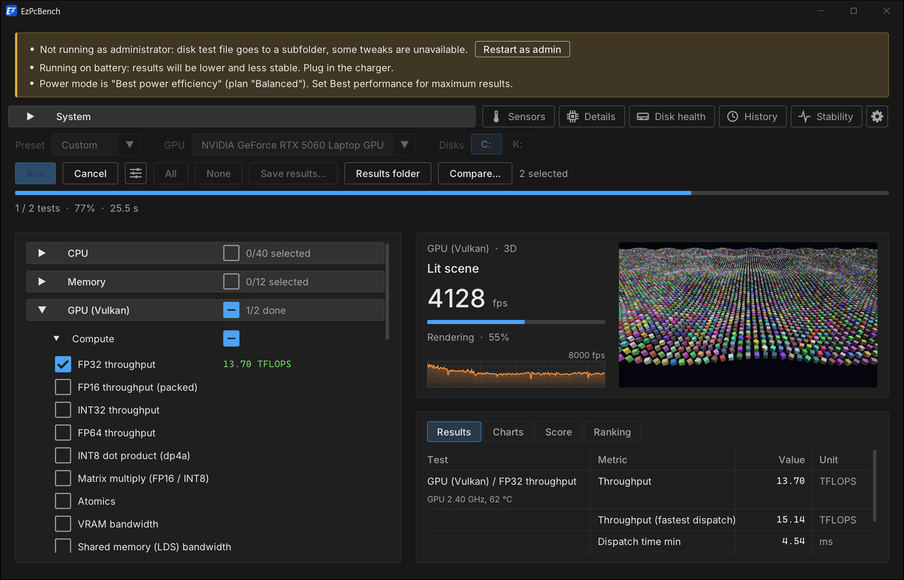

# ez-pc-bench

A small native Windows benchmark for CPU, memory, GPU (Vulkan and Direct3D 12) and disks. It reports raw
numbers (GFLOPS, GB/s, ns, IOPS, FPS) with explicit units. It comes as a GUI and a command-line exe
that run the same tests. Website: <https://0xrsp.github.io/ez-pc-bench/>.



## Features

### Done

**Benchmarks**
- [x] **CPU:** integer and FP32/FP64 FMA throughput (scalar, AVX2, AVX-512), SGEMM, SHA-256, AES, sort and
  prime sieve, plus real-world workloads: compression (Windows codecs and LZ77), JPEG / PNG decode and
  resize, JSON and text parsing, FFT, n-body, ray-box / ray-triangle, CRC32C, xxHash, AES-GCM, ChaCha20,
  int8 / BF16 dot products and π to a million digits. Single-threaded and all threads; every test checks
  its own output. Also a core-to-core latency matrix, thread scaling, a per-core pass, P / E core results
  on hybrid CPUs, and instruction-latency / branch / code-size probes. AVX2 / AVX-512 tests run only on
  CPUs that have them (greyed out otherwise); hot loops have AVX2 and baseline versions.
- [x] **Memory:** read, write, copy and triad bandwidth, an AIDA64-style L1 / L2 / L3 / DRAM grid, latency
  from 4 KiB to 1 GiB, latency under load, read/write mixes, thread scaling and cache bandwidth sweeps.
- [x] **GPU (Vulkan + D3D12):** both APIs run the same shaders, so their numbers compare directly
  - compute: FP32, FP16, FP64, INT32, int8 dot products, matrix multiply (Vulkan cooperative matrix),
    atomics, VRAM / shared-memory / PCIe bandwidth, GPU cache and memory latency
  - 3D: triangles, fill rate, texture fill and formats, anisotropic filtering, draw calls, a lit scene, with
    avg / p99 / p99.9 frame times and a live preview; offscreen or on screen (real swapchain)
  - features: ray tracing, mesh shaders, tessellation, variable-rate shading, sampler feedback, async compute
  - 2D: sprites, blit and clear; pipeline compile time; several GPUs in one run
- [x] **Disk:** CrystalDiskMark-style SEQ1M / RND4K rows at several queue depths with read-only /
  write-only / mixed modes, MB/s, IOPS and latency percentiles (p50 to p99.99, max) for every test; QD1
  read / write / flush latency, latency under background writes, wake-from-idle latency, small-file
  operations, queue-depth / block-size / compressibility sweeps, file-copy workloads, a sustained-write
  (SLC cache) test, TRIM recovery, and full-drive read, surface scan and seek profile (admin). Any drive
  or folder.

**Run options**
- [x] One-click presets (Quick, Standard, Extended, Sustained, Score), repeat N times with median and
  spread, sustained mode (loop each test for minutes and report the drop).
- [x] Clocks, load, temperatures, power and hardware errors (WHEA) recorded during every test and saved
  with the results, with warnings for clock drops, battery and heat.

**Tools**
- [x] **Sensors:** a Task Manager-style overview (device list with mini graphs; CPU, GPU, memory, drive,
  power and temperature graphs): per-core clock and load, CPU package and per-core power, GPU clocks / load /
  VRAM / power / PCIe link, memory in use, battery charge and discharge rate, temperatures; search box, sensor
  log (CSV) and an on-screen overlay.
- [x] **Disk health (CrystalDiskInfo-style):** SMART table with vendor names, Good / Caution / Bad,
  drive info, NVMe details, self-tests, USB enclosures, text report (`--health`).
- [x] **Stability tester:** self-checking CPU, cache and per-core load, memory error test, VRAM test, GPU
  error detection, combined CPU + GPU load, disk verify, WHEA counts and temperature limits (`--stress`).
- [x] **System details:** CPU (codename, microcode, clocks, ISA flags, caches, core map), RAM modules,
  board / BIOS / chipset, GPUs (driver, feature level, Vulkan extensions, Resizable BAR), displays, PCI
  tree with link speeds, USB, network and audio devices, Windows settings that skew results (VBS, memory
  integrity, Game Mode, HAGS); exportable report (`--sysinfo`).

**Results**
- [x] TOON text files; a compare window for up to 16 runs (summary, per-suite tabs, change vs a reference,
  copy table, Copy PNG, HTML report); a built-in library of reference runs; automatic run history with
  trend charts; ranking against the library.
- [x] An overall score (preliminary) derived from the raw results by a published, versioned formula, with
  CPU single-thread, CPU multi-thread, memory, GPU and storage components. Raw numbers stay primary.
- [x] Graphs in one Task Manager-like style everywhere (live panel, charts, history, sensors, stability),
  colored by what they measure: load, clock, power, temperature, memory, latency, disk.
- [x] Color themes: plain Light and Dark (or follow Windows) plus Solarized Dark / Light, Monokai, Dracula,
  Nord, Gruvbox Dark, One Dark, Catppuccin Mocha / Latte and GitHub Light.
- [x] GUI and CLI with the same tests; settings saved automatically; the GUI updates itself from GitHub
  releases (checked at start, hash-verified, one click).

### To do

The full plan, with priorities and sources, is in [docs/FUTURE.md](docs/FUTURE.md); open questions are
in [docs/PLAN.md](docs/PLAN.md) §11.

- [ ] **Test what this PC can't:** the raw-disk tests and drive self-tests (admin), SATA / USB / RAID
  drives, hybrid P / E cores.
- [ ] **Score calibration:** results and real-task timings from other machines, so the weights can be
  fitted and the "preliminary" label dropped; then score v2 with the new CPU and disk-latency tests.
- [ ] **Stability:** GPU tests on Vulkan, VRAM test on every GPU in one run, saved stability settings.
- [ ] **GPU:** memory type and bus width, ray-tracing pipelines (DXR 1.0), present-timing stats on Vulkan.
- [ ] **App:** keyboard navigation, localization; support for more hardware (processor groups, NUMA,
  ARM64), tray mode waits on a decision in FUTURE.md §0.
- [ ] **Later:** a Cinebench-style CPU render and a Heaven-style heavy GPU scene.

## Download

Get `ez-pc-bench.exe` (GUI) and/or `ez-pc-bench-cli.exe` from
[Releases](https://github.com/0xrsp/ez-pc-bench/releases). You need Windows
10/11 x64 (any CPU with SSE4.2 and POPCNT, i.e. x86-64-v2; AVX2 / AVX-512 only for the tests that use them)
and a GPU driver with Vulkan support (it installs `vulkan-1.dll`). The GPU
tests need D3D12 and Vulkan 1.3. The GUI checks for a newer release on startup and shows an **Update
available** button at the top right when there is one (`--no-update` skips the check).

## Build

Requirements:
- LLVM (clang-cl + lld)
- CMake ≥ 3.29 and Ninja
- MSVC build tools with a Windows SDK
- Vulkan SDK

```
cmake --preset release
cmake --build --preset release -- -j 6
```

This builds `build\release\ez-pc-bench.exe` (GUI) and `ez-pc-bench-cli.exe`. No developer prompt or
vcvars is needed.

## Usage

**GUI:**
1. Pick a **Preset** (or your own selection), the GPU(s) and disk(s) at the top.
2. Tick the tests you want and press **Run**. The sliders button next to it opens **Benchmark settings**
   (phase duration, repeats, sustained mode, GPU render resolution, disk file size and passes); presets
   set all but the resolution.
3. **Save results...** asks for an optional run name (Enter keeps the default, e.g.
   `ezbench_20261111_113811_r7-250_rtx5060-laptop`) and writes `results\<name>.toon.txt` next to the exe.
   Every finished run is also saved to `results\history\`.
4. **Compare...** opens the compare window. Add saved results (or drop files onto the window), the
   current run, or reference runs from the built-in **Library...** to see them side by side: an
   overall / per-suite summary, the score, system info, raw values and the change vs a reference run.
   **Copy table** and **Copy PNG** put it on the clipboard.

The buttons on the System row open **Sensors**, **Details** (system information), **Disk health**,
**History**, **Stability** and the **settings** (gear). Each opens in its own window; hover any setting
for a detailed description.

The app asks for admin rights at start. They are optional; without them a few tweaks and the raw-disk
tests are skipped.

**CLI:**

```
ez-pc-bench-cli --list                            # test ids
ez-pc-bench-cli --run cpu,mem --out run.toon.txt  # run suites / ids / patterns
ez-pc-bench-cli --preset quick --score            # a preset, then the score breakdown
ez-pc-bench-cli --compare run.toon.txt            # run and diff against a saved run
ez-pc-bench-cli --health                          # drive health report
ez-pc-bench-cli --stress cpu,mem --minutes 10     # stability test
ez-pc-bench-cli -h                                # everything else
```

Results are plain [TOON](https://github.com/toon-format/toon) text files.

## Tips

- For stable numbers: use AC power with Windows power mode *Best performance*, and close other apps
  (games especially).
- The disk tests use one temporary file per drive (`<drive>:\ezbench.tmp`). It is deleted automatically,
  even after a crash. A full default disk run (best of 3 passes) writes about 80 GB, so use
  `--passes 1` for frequent runs.

## Reference runs

Runs I made on the PCs I've tested live in [library/](library/) and are built (compressed) into the GUI,
so you can add them from **Library...** in the compare window. The main reference is a Ryzen 7 250 /
RTX 5060 Laptop / Samsung NVMe laptop on AC, Best performance, as admin:
[library/2026-11-11_r7-250_rtx5060-laptop.toon.txt](library/2026-11-11_r7-250_rtx5060-laptop.toon.txt).

## License

Design notes and measurements: [docs/PLAN.md](docs/PLAN.md).

MIT licensed, see [LICENSE](LICENSE). Third-party: Dear ImGui (MIT), Inter font (SIL OFL 1.1).
