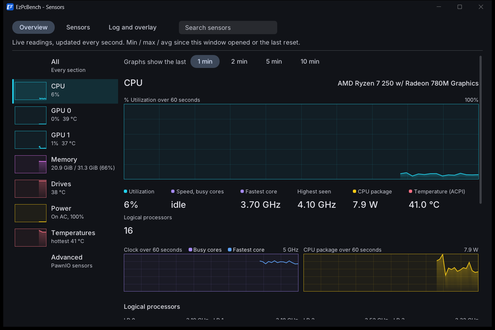
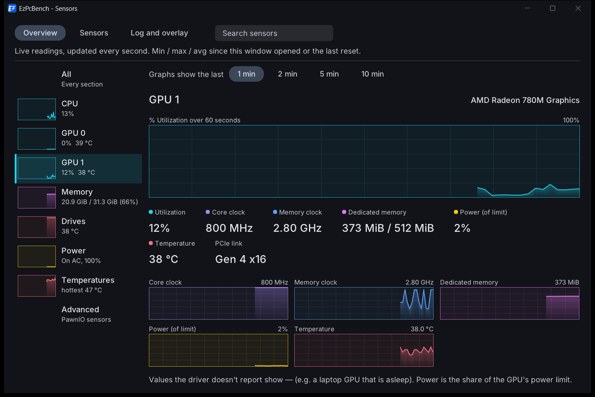
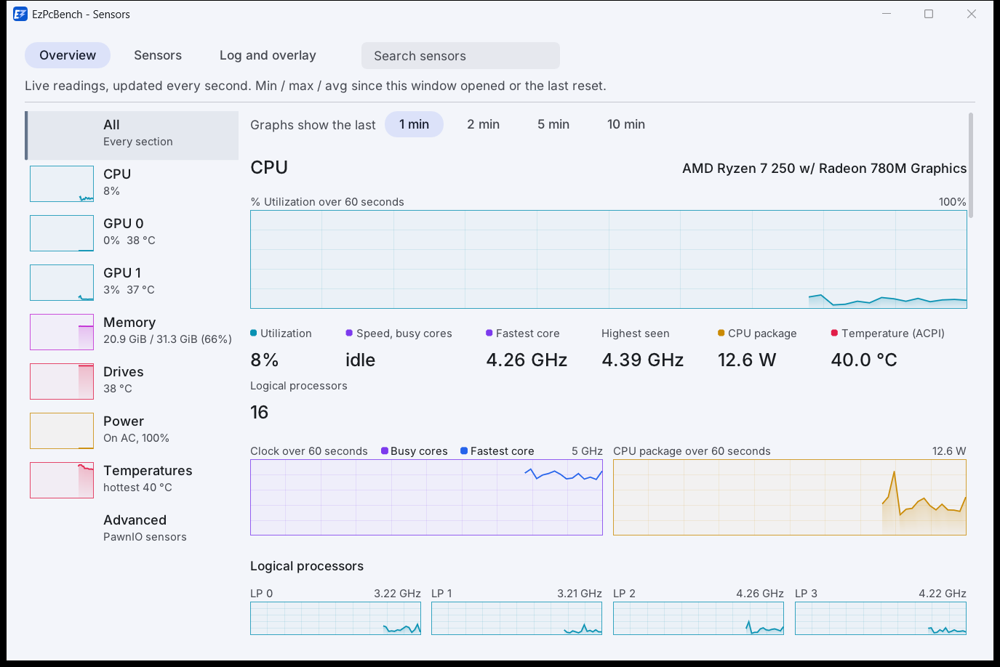
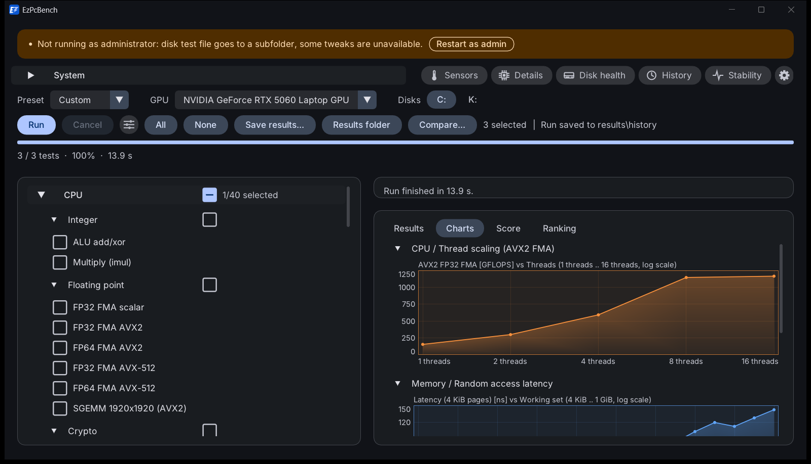
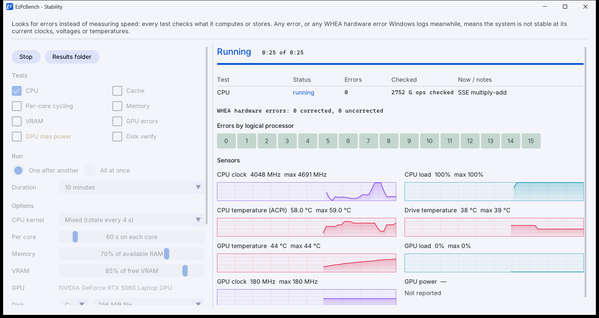

# Graphs (shared widget) and the Sensors window rebuild

Stream notes for merging into PLAN.md. Built 2026-11-12 on a worktree branch from `dev`.

## Look

Windows Task Manager's Performance page: each graph is a box with a neutral 1 px border and a faint 10 x 5 grid
(theme colors, see Colors), the line in the series color over a translucent fill (fading towards the bottom), a
small caption above (title left, range max or current value right). Time series scroll right to left, newest
sample at the right edge (a fresh graph fills in from the right). Big numbers with small labels (`graph_stat`)
sit under the large graphs. No new dependency: everything is ImDrawList (`fill_under` writes the gradient
strip with `PrimReserve`, so adjacent segments have no anti-aliasing seams).







## API (`src/app/graph.h`)

```cpp
struct GraphLine { const f32* y; u32 n; const f32* x; const char* name; i32 kind; const u8* marked; };
struct Graph {
    const char* title, *right; ImU32 right_col; const char* unit; GraphKind kind; u32 flags;
    f32 lo, hi, min_span; i32 decimals;            // NaN ends = from the data, snapped to a 1/2/2.5/5 step
    u32 window; f32 step_s;                         // time series: samples across the width, seconds per sample
    const char* x_unit; fmt_x, fmt_y, user;         // x/y: format_x() unit or custom label callbacks
    ImU32 mark_col;                                 // color of `marked` points
};
GraphHit graph_time(id, const Graph*, const GraphLine*, count, ImVec2 size);   // time series
GraphHit graph_xy(id, const Graph*, const GraphLine*, count, ImVec2 size);     // x/y with tick labels
void graph_bar(frac, marker, ImVec2 size, ImU32 col);   // horizontal bar (score / ranking)
void graph_stat(label, value, kind);                     // small label over a big number
GraphKind graph_kind_for_unit(unit);  ImU32 graph_color(kind, alpha);  u32 graph_rgb(kind, dark);
void graph_format(buf, size, v, unit, decimals);         // MHz >= 1000 as GHz, MiB >= 1024 as GiB, "15%"
```

- `size` is the whole item including the caption; `size.x <= 0` = available width.
- Flags: `GF_SPARK` (thumbnail: no caption / grid / hover, a Dummy so it can sit inside a Selectable),
  `GF_NO_CAPTION`, `GF_ZERO` (automatic range includes 0), `GF_VALUE` (current value inside, top left),
  `GF_NO_TOOLTIP` (caller shows its own from the returned `GraphHit`), `GF_LOG_X`, `GF_POINTS`, `GF_NO_FILL`.
- Several lines: line 0 in the kind's color, the others in companion hues (or `GraphLine::kind`); a legend with
  color chips goes into the caption; only single-line graphs get the fill.
- Hover: a vertical guide and a dot per line; the default tooltip lists each line's value (with "12 s ago" when
  `step_s` is set; x/y: the x label first). `GraphHit` returns the hovered line / point either way.
- Grid lines are skipped in boxes under ~1.8 font heights (table-row graphs); x/y graphs put their vertical grid
  lines on the labelled ticks (data points that fit without overlapping).

## Colors (per theme: `Palette::series`, the theme table in theme.cpp)

Since the theme rework (docs/notes/themes.md) only the line, its fill, the legend chips and `graph_stat` dots
carry the kind's hue. Box border = `ImGuiCol_Border` (the frames' border), grid = `outline_variant`, background
= text color at 2.5 % (dark) / 2 % (light). Each theme has its own nine hues in `GraphKind` order (Solarized's
cyan / violet / yellow / red / magenta / blue / green / orange, Dracula's, ...); the unit → kind mapping stays in
graph.cpp. The plain Dark and Light hues below (Light now uses the 700 steps where the 600 steps were under
4.5:1 on white); the overlay (GDI, always a dark panel) uses the Dark hues via `graph_rgb(kind, true)`.

| Kind | Units | Dark | Light |
|---|---|---|---|
| `GK_LOAD` load / utilization | `%` | `#22D3EE` cyan | `#0E7490` |
| `GK_FREQ` clock | `MHz`, `GHz`, `kHz` | `#A78BFA` violet | `#7C3AED` |
| `GK_POWER` power | `W`, `mW`, `V`, `Wh` | `#FACC15` amber | `#A16207` |
| `GK_TEMP` temperature | `°C` | `#FB7185` rose | `#E11D48` |
| `GK_MEMORY` memory / bandwidth | `GB/s`, `GiB/s`, `TB/s`, `B`, `KiB`, `MiB`, `GiB`, `MB`, `GB` | `#E879F9` magenta | `#C026D3` |
| `GK_LATENCY` latency / time | `ns`, `µs`, `us`, `ms`, `s`, `clk`, `cc`, `cycles` | `#60A5FA` blue | `#2563EB` |
| `GK_DISK` disk throughput / IOPS | `IOPS`, `MB/s`, `MiB/s`, `KB/s` | `#4ADE80` green | `#15803D` |
| `GK_RATE` compute throughput | `fps`, any other `*/s` (`Gops/s`, `Mtri/s`, `PSO/s`), `*FLOPS`, `*OPS` | `#FB923C` orange | `#EA580C` |
| `GK_OTHER` count / other | `RPM`, `x`, score, anything else | `#94A3B8` slate | `#64748B` |

Dark shades are the 400 steps (light on near-black), light shades the 600 / 700 steps (contrast on white).
Charts of disk tests use `GK_DISK` for throughput units whatever the unit string (`chart_kind` in ui.cpp: memory
/ rate / other kinds of a `SUITE_DISK` test become disk). Fill 30 % / 24 % at the line, 4 % at the bottom.

## Screens

| Screen | Before | Now |
|---|---|---|
| Live panel (ui.cpp `draw_live`) | `PlotLines`, primary color | `graph_time`, colored by the running test's unit, zero-based, max in the caption; scrolls in over 64 samples, then spans the whole history (`LIVE_HISTORY` = 256) |
| Charts tab series (ui.cpp `draw_series`) | one `PlotLines` per metric name, evenly spaced x | `graph_xy` with real x, axis tick labels, a dot per point, hover tooltip with the exact x / value. **Lines with the same unit share one graph** (up to 6, e.g. Read / Write), legend in the caption. Log x when most x steps are x1.4 or more (block sizes, working sets, queue depths, thread counts 1/2/4/8/16) |
| Charts tab sustained (ui.cpp `draw_sustain`) | `PlotLines` per tracked metric | `graph_xy` per metric, x = pass, tooltip "Pass N (ended at T s)" |
| Charts tab matrix | table heat map | unchanged (table) |
| Memory grid (mem_charts.cpp) | table | unchanged (table) |
| Loaded latency (mem_charts.cpp) | hand-drawn axes | `graph_xy`, latency color, x = bandwidth; no fill if bandwidth isn't rising; same tooltip text |
| History trend (history_ui.cpp) | hand-drawn | `graph_xy`, x = run (dates as tick labels), flagged runs marked in the warning color, same tooltip |
| Stability sensor graphs (stability_ui.cpp `graph`) | `PlotLines` | `graph_time`, kind per series (clock / load / temperature / power), header line unchanged |
| Score and Ranking bars (score_ui.cpp `bar`) | rounded pills | `graph_bar`: tinted track, gradient fill with an outline, reference marker; callers' colors unchanged |
| Sensors window | see below | |
| Overlay (overlay.cpp, GDI) | gray labels | each label in its unit's graph color (dark shades); values stay white |

Not converted: `adv_ui.cpp` (PawnIO section, the PawnIO stream's file) still has one `PlotLines` per PawnIO
sensor row. Switching it is a five-line change: `Graph g; g.kind = GK_TEMP; g.lo = lo; g.hi = hi; g.flags =
GF_NO_CAPTION; graph_time("##hist", &g, &line, 1, ImVec2(0, line * 2))`.

## Sensors window

- **Overview** is now Task Manager-like: a device list on the left, the selected device on the right.
  - List entries: All, CPU, GPU n, Memory, Drives, Power, Temperatures, Advanced (PawnIO). Each has a sparkline
    thumbnail (CPU load, GPU load, memory in use, hottest drive, battery rate, hottest thermal zone) and a
    one-line summary ("12%  4.63 GHz", "20.8 GiB / 31.3 GiB (66%)", "On AC, 100%", "hottest 42 °C"). The
    selected entry is tinted in its color with an accent bar.
  - **All** stacks every section; with a search active the right side always shows the matching sections and
    the list only the devices with a match ("All" highlighted). Picking a device clears the search.
  - CPU: "% Utilization over 60 seconds" (large), stats (Utilization, Speed of busy cores, Fastest core, Highest
    seen, package power, Temperature: a `cpu.temp*` channel if one appears (PawnIO), else the hottest ACPI zone,
    labelled "(ACPI)"; Logical processors), clock graph (busy cores + fastest core, two lines) beside the package
    power graph, one load tile per logical processor (4 columns up to 16 LPs, the LP clock in the caption), then
    per-core power tiles.
  - GPU (per adapter): utilization graph, stats (load, core / memory clock, dedicated memory used / total, power
    % of limit, temperature, fan, PCIe link with the old tooltip), tiles for the channels this GPU reports.
  - Memory: `GlobalMemoryStatusEx` once a second in the UI thread while the window is open (own 600-point ring,
    cleared on close): in-use graph (0..total), In use / Available / Committed of the commit limit / Load.
  - Drives and Temperatures: one tile per reading (channel history; caption value turns warn / error colored
    near / over the threshold; hover: detail, min / max, threshold or the "no reading" note).
  - Power: battery stats (state, rate, charge with Wh, voltage, time left), the battery info line with wear and
    cycles, tiles for rate / charge / voltage (/ temperature), then the non-CPU rails as tiles.
  - Graph span: 1 / 2 / 5 / 10 minutes (tabs above the detail; the channel history holds 10 min).
- **Sensors** tab: the row graphs are `graph_time` in the unit's color (no caption, no grid at row height).
- **Log and overlay** tab: the two parts are `theme_group_begin("Sensor log")` / `("Overlay")` boxes.
- `adv_ui_draw_sensors()` is the "Advanced" device and the last section of All (shown under a search when the
  search matches its topics, as before).
- New `[sensors]` ini keys: `graph_window` (0..3) and `device` ("all", "cpu", "gpu0", "memory", "drives",
  "power", "temps", "adv").
- New GUI dev flag `--sensor-view <overview|sensors|log|device>`: session-only tab or Overview device (a device
  key opens the Overview on it), for screenshots. Parsed in main_gui.cpp next to `--sensor-filter`.

## For the lead

- Shared files touched: `CMakeLists.txt` (graph.cpp in the GUI sources), `src/app/main_gui.cpp`
  (`--sensor-view`, 4 lines), `src/app/ui.cpp` (include, `chart_kind`, `draw_live` graph block, `draw_series` /
  `draw_series_lines` / `draw_sustain` rewritten, `draw_series(r, b->suite)` call), `stability_ui.cpp` (the
  PlotLines block in `graph()` and an include), `history_ui.cpp` (`draw_chart` rewritten, include),
  `score_ui.cpp` (`bar` body), `mem_charts.cpp` (`draw_loaded`), `overlay.cpp`. Not touched: theme.*, adv_ui.*,
  core/*.
- CLAUDE.md: add `--sensor-view overview|sensors|log|<device>` to the GUI dev flags.
- PLAN.md: decision log entry for the shared graph widget and the unit → color table (graph colors are
  independent of the theme palette); Sensors window description (device list, All, graph span, memory section);
  the `[sensors] graph_window` / `device` keys.
- Merge note: if the theme stream changes `ImGuiCol_Header`, nothing here depends on it (the device list draws
  its own selection).
